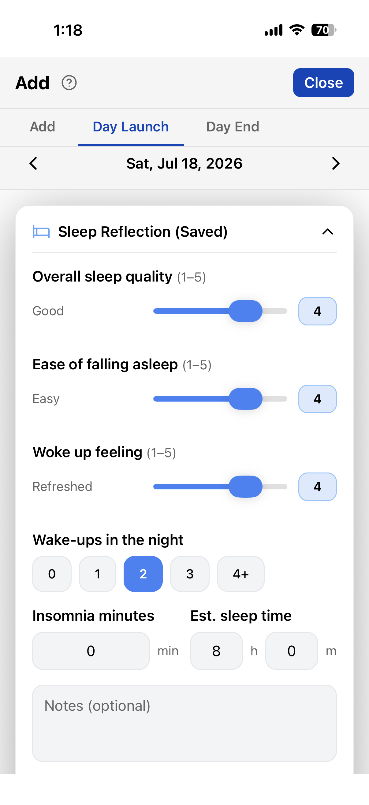
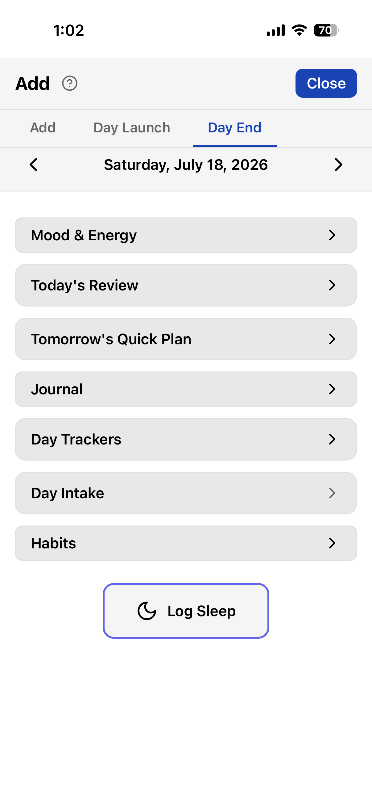
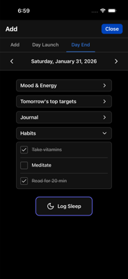

# Day Launch & Day End

For those who want structured daily reflection, TriLog offers Day Launch and Day End screens. These are optional—you can use TriLog perfectly well without them.

## Day Launch

Day Launch is for mornings. It captures how you slept and sets up your day.

Access it from the Add Entry modal by tapping the "Day Launch" tab.

### Sleep Tracking

Day Launch captures detailed sleep information:

- **Sleep Quality** — How well did you sleep? (1-5 scale)
- **Sleep Onset** — How easily did you fall asleep? (1-5 scale)
- **Waking Feeling** — How did you feel upon waking? (1-5 scale)
- **Wake-ups** — How many times did you wake during the night?
- **Sleep Duration** — Total hours and minutes of sleep
- **Insomnia** — Time spent awake trying to sleep

This creates a sleep record you can correlate with your day's mood and energy. Over time, you'll see how sleep affects how you feel.

### Today's Goals

Day Launch shows **Today's goals** — a read-only list of up to three priorities you set last night in Day End → **Tomorrow's Quick Plan**. You can see what you intended to do, but you cannot edit or check them off here.

To mark goals complete, use Day End → **Today's Review** or **Menu → Tools → Daily Goal Log** (today only). Both stay in sync.

### Wake Up (Free)

A single-tap **Wake Up** button on Day Launch logs an "Other" activity at the current time. Use it as the morning bookend that pairs with **Log Sleep** at Day End — together they anchor your day so the chart shows a clean sleep → awake transition without you having to dig into the Add dialog.

The button auto-disables once any non-sleep activity is logged that day (so you know wake-up is already marked).

### Morning Routine (Pro)

Pro users can set up a morning routine checklist. Common items:
- Make bed
- Meditate
- Exercise
- Review calendar

The routine uses markdown formatting, so you can customize it however you like.

---

## Day End

Day End is for evenings. It prompts reflection on your day and planning for tomorrow.

Access it from the Add Entry modal by tapping the "Day End" tab.

### Tomorrow's Quick Plan

Set up to three intentions for the next day:

- Task 1: Most important thing to accomplish
- Task 2: Secondary priority
- Task 3: Nice to have

These are saved on tomorrow's day entry and appear as **Today's goals** in the next morning's Day Launch.

### Today's Review

Check off the goals you set yesterday evening. The same checkboxes appear in **Menu → Tools → Daily Goal Log** for today only — checking in either place updates both.

### Daily Goal Log

**Menu → Tools → Daily Goal Log** is a running history of your top three goals for each day.

- **Today** — interactive checkboxes (synced with Day End → Today's Review)
- **Past days** — read-only: green ✓ if completed, red ✗ if not, plus a daily score (completed out of total)

Goals can only be *entered* in Day End → Tomorrow's Quick Plan. The log is for completing and reviewing them.

### Journal

Space for longer reflection. What happened today? What's on your mind? What do you want to remember?

This is optional. Many people skip it entirely. Others find it valuable for processing the day.

### Habits

If you've set up daily habits, Day End shows them as checkboxes. Check off what you completed.

### Wellness Check

Day End can include wellness assessments—simple ratings of how various aspects of life are going. Configure these in Settings.

### Resting Heart Rate (Pro, iOS)

If you have an Apple Watch or compatible device, Day End can display your resting heart rate. This metric often correlates with recovery, stress, and overall health.

Enable in Settings → Appearance → Resting Heart Rate.

### Day Trackers (Pro)

If you've enabled the Trackers feature, the Day-End view shows a **Day Trackers** section listing each of your day trackers (mood ratings, traffic-light symptoms, on/off flags, etc.). Tap a row to set or update today's value — the editor matches the tracker's type (0–5 picker, red/yellow/green picker, on/off toggle).

One entry per day max; saving replaces that day's value. See [Trackers](pro-features.md#trackers) for full details.

### Day Intake (Pro)

When **Intake Tab on Add** is enabled in Settings, Day End also shows a **Day Intake** section in the same card as Day Trackers. Log caffeine, vitamins, medications, water, and other consumables with structured amounts — separate from freeform notes or tracker shorthand.

Pick an item from your Intake Library, set the quantity, and save. Today's logged intake appears in the section so you can review or delete entries. You can also log from the Add dialog's **Intake** tab anytime during the day.

See [Intake](intake.md) for the full library setup, logging flow, and how intake differs from event trackers.

---

## Using Day Launch & Day End

### The Full Routine

Some people use both every day:

**Morning (Day Launch)**
1. Record last night's sleep
2. Review today's goals (set last night)
3. Complete morning routine checklist

**Evening (Day End)**
1. Check off today's goals in Today's Review
2. Set tomorrow's goals in Tomorrow's Quick Plan
3. Write a brief journal entry
4. Check off completed habits
5. Note anything significant

### The Minimal Approach

Others use just pieces:

- Sleep tracking in the morning only
- Goal setting in the evening only
- Habits without the journal

Use what helps. Skip what doesn't.

### When to Use Them

Day Launch works best shortly after waking—sleep details are fresh.

Day End works best before bed—the day is complete, tomorrow can be planned.

But timing is flexible. A lunch-time Day Launch still captures useful sleep data. A morning Day End can reflect on yesterday.

---

[← Back to Guide](index.md) · [Next: Viewing Patterns →](viewing-patterns.md)
