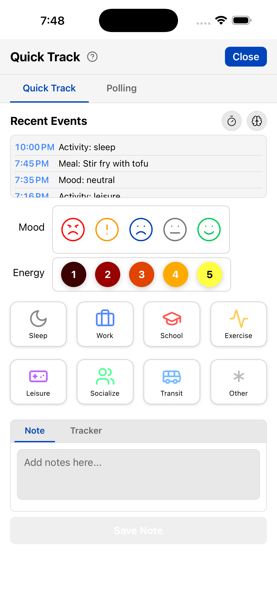
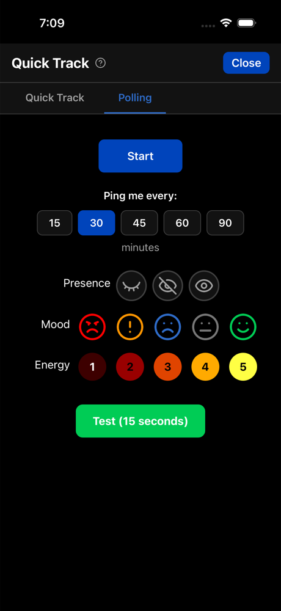
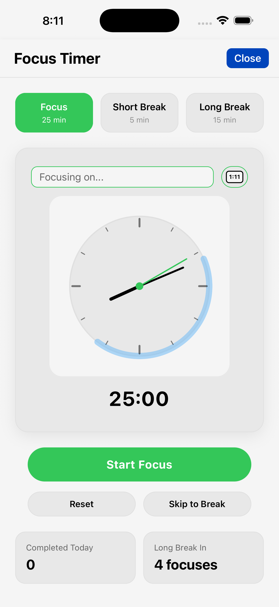
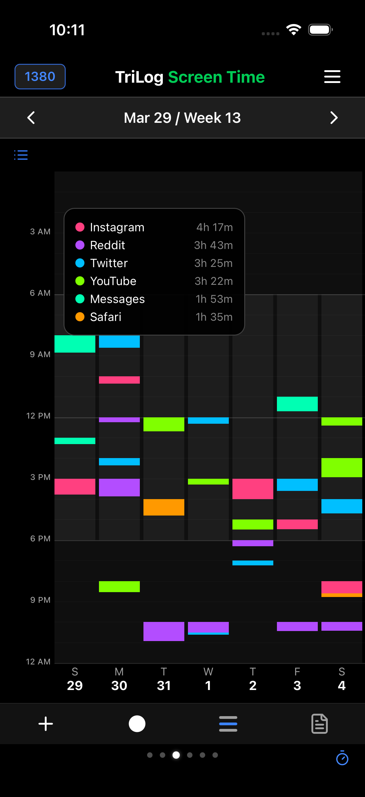
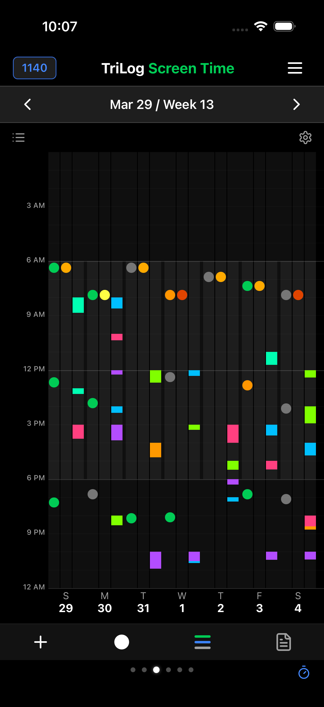
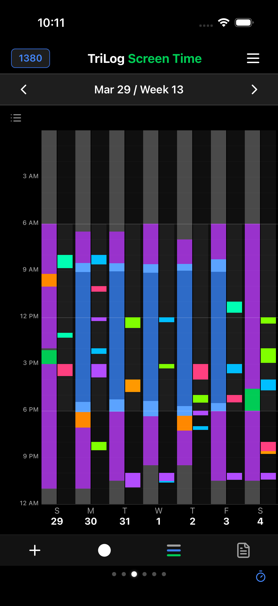
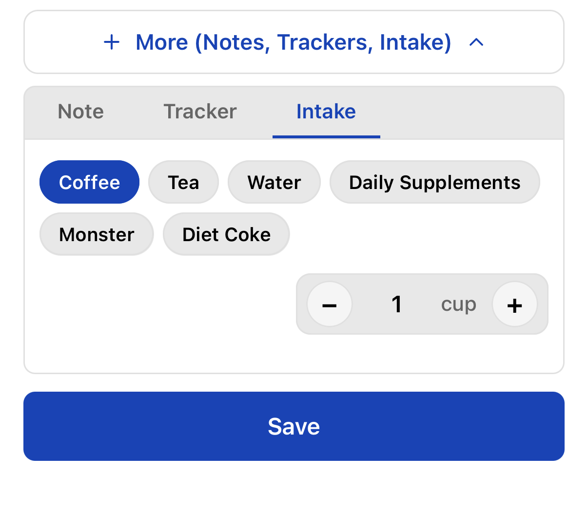
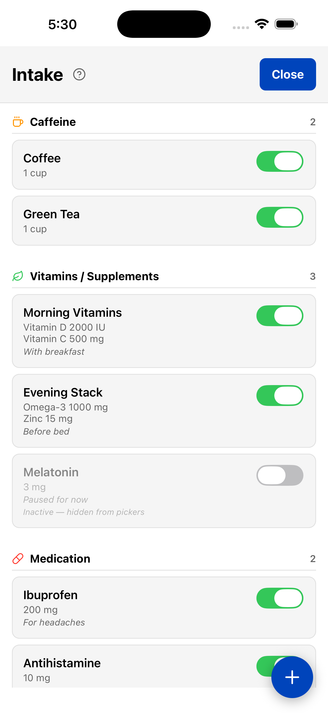
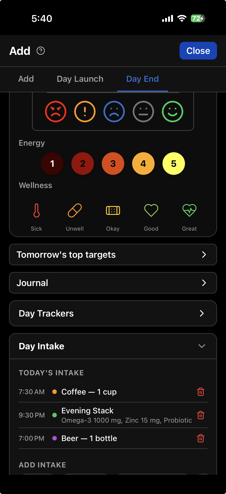
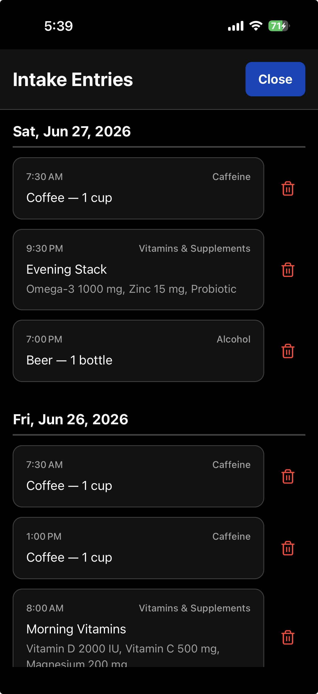

# Pro Features

TriLog is one product — everything below is included. The first 30 days are free; after that a subscription keeps logging enabled (see [About the Subscription](#about-the-subscription) at the bottom). This chapter tours the power-user features.

## Quick Track

Quick Track provides rapid entry logging without opening the full add modal.


### How It Works

1. Tap the **circle-dot button** in the bottom bar
2. **Tap your mood** — logged immediately
3. **Tap the energy slider** — saves the moment you lift your finger
4. Optionally open **More** for a Note, Tracker entry, or Intake

The whole process takes seconds. Recent Events at the bottom shows what you just logged — swipe left on any entry to delete it.

### When to Use Quick Track

Quick Track shines when you want frequent data points without friction:

- Responding to a Polling notification
- Logging quickly during a busy day
- Capturing mood shifts as they happen



---

## Polling

Polling sends periodic notifications asking how you're doing.



### How It Works

1. Open Quick Track and switch to the **Polling** tab
2. Pick an interval (e.g., every 2 hours) — or use scheduled times via Menu → Tools → Scheduling
3. Receive gentle notifications throughout the day
4. Tap to open Quick Track and log your state

### Why Polling Helps

Without reminders, most people log sporadically. Polling creates regular data points—a more complete picture of your day.

The notifications are gentle. Ignore them if you're busy. Respond when you can.

### Configuration

- **Interval** — How often to send notifications
- **Alarm sound** — Pick the notification sound
- **Test** — Send a test notification immediately

---

## Focus Timer

A classic 25-minute Pomodoro timer integrated with your tracking. Open it from **Menu → Tools → Focus Timer** or the **brain icon** in Quick Track.



### The Technique

The Pomodoro Technique uses timed work intervals:

1. **Focus** — 25 minutes of concentrated work
2. **Short Break** — 5 minutes of rest
3. **Repeat** — After 4 focus sessions, take a long break (15 minutes)

### Features

- **Three modes** — Focus, Short Break, Long Break
- **Customizable sounds** — Different sounds for session start/end
- **Keep Screen On** — Optional setting to prevent screen sleep
- **Analog or Digital** — Choose your preferred clock display
- **Session History** — Track completed sessions
- **Daily Count** — See how many focus sessions you've completed today (also a **Focus Timer** row in the Metrics grid)

### Focus Text

Optionally set a focus intention before starting. What will you work on? This gets logged with the session.

### Integration

Completed Pomodoro sessions integrate with your TriLog data. See how focused work correlates with mood and energy.

---

## Screen Time

Screen Time shows your app usage alongside mood, energy, and activities on a single chart. This makes it easy to spot how device usage relates to how you feel.



### Display Modes

Screen Time offers multiple display modes so you can compare patterns from different angles:

**Mood & Energy** — Overlay screen time with your mood and energy trends to see correlations.



**Activity** — See screen time alongside your activity data to understand how device usage fits into your day.



### What You Might Notice

- High screen time in the evening correlating with worse sleep quality
- Social media spikes during low-energy periods
- Reduced device usage on days with more exercise or social time

Screen Time doesn't judge — it just puts the data side by side so patterns become visible.

---

## Analysis (Advanced)

**Menu → Analysis** opens a launcher of reports — **Basic** (Patterns, Base Chart, Day Ratings, and the cycle/intake overlays) and **Advanced**:

- **Correlations** — which factors track with energy and mood
- **Best vs Worst Days** — what high- and low-energy days have in common
- **Scatter** — plot any factor against energy or mood
- **Energy by Category** — average energy by workouts, alcohol, day of week, trackers, and more

See [Analysis](analysis.md) for screenshots and details.

---

## Day View with Sun Clock

Day View shows today's track alongside an astronomical sun clock — sunrise, sunset, the current position of the sun, plus moon phase and season. The background changes with daylight. Tap the sun for a day info page with weather, pollen count, and other context.

Enable it in **Settings → Appearance → Day View**, then swipe to it from the main chart.

---

## Scheduling

Set reminders at specific times of day to check in. Access Scheduling from **Menu → Tools → Scheduling**.


Pick the times that match your routine — morning, midday, evening — and TriLog will send a notification prompting you to log. This pairs well with Quick Track for fast responses to reminders.

---

## Siri Input

Log entries hands-free using Siri. Say something like "Log my mood in TriLog" to create an entry without opening the app. Useful when you're on the go or want minimal friction.

---

## Trackers

Track anything beyond mood and energy — symptoms, supplements, medications, ratings, habits. The point is finding correlations: *"did my energy drop on the days I forgot magnesium?"*

There are two kinds of trackers, designed for different rhythms:

### Day Trackers

One entry per day, edited from the Day-End view. Use for things you assess once a day at the end of it: daily mood, sleep quality, pain level, whether you took your meds.

**Day tracker types:**

- **Text** — A single end-of-day note. Grid shows a blue square for any day with a note.
- **Rating** — A 1–5 rating set with a slider. Pick a color scheme per tracker (black→white, red→green, or dark-red→yellow); the grid shows the number.
- **Traffic Light** — A 1–5 status shown as a colored square (red → green).
- **Itemized List** — Define a fixed list (e.g., "morning supplement stack"); mark each day yes/no for completion.
- **Toggle** — Stateful on/off flag. Stays on until you flip it off — perfect for "on antibiotics" or "on vacation."

### Event Trackers

Logged many times a day, each timestamped. Use for things that happen at moments: caffeine doses, headache flares, brain-fog ratings.

The grid always shows a number per day:
- **Sum** → adds the values you logged
- **Average** → averages them
- Every other type → counts the entries

**Event tracker types:**

- **Text** — A free-form note. Grid shows the count.
- **Number** — Each entry is a number. Pick **Sum** (cumulative — caffeine mg, water oz) or **Average** (snapshot ratings averaged).
- **Rating** — A 1–5 rating logged through the day, set with a slider in the tracker's color scheme. Grid shows the count; on the Trackers chart, each entry's dot takes the color of its value. When something resolves (a headache going away), just stop logging it.
- **Traffic Light** — A 1–5 rating shorthand. Grid shows the count.
- **Itemized List** — A fixed list (e.g., a morning supplement stack). Each entry = "took the whole list."

### Three Ways to Log

1. **Type a note.** Start any journal note with `t key value note` (e.g., `t caf 100 espresso`). Works from Siri voice entries too.
2. **Use the Tracker tab** on the Add (+) dialog — pick a tracker from the list and fill in the type-specific input. No key to remember. Enable in Settings → Appearance → "Tracker Tab on Add."
3. **From the grid.** Tap any cell in the Trackers grid to view, edit, or add entries for that day.

### Creating a Tracker

1. Open Menu → Extras → Trackers
2. Tap the **+** button
3. Pick **Day** or **Event** tracker
4. Enter a label (display name)
5. Pick a category (general, symptom, event, medicine, supplement) and a type
6. Save

For event trackers, you'll also pick a short key (e.g., `caf` for caffeine) used in the freeform text format. Day trackers don't need a key — they're never logged as notes.

### Viewing Trackers

The dedicated Trackers grid (enable in Settings → Appearance → Trackers View) shows every tracker across days side-by-side. Day Trackers appear on top, Event Trackers below. Toggle between 7- and 21-day views with the toolbar button. Tap any cell to view, edit, or add entries.

The view also has a **chart mode** (grid/chart toggle in the toolbar): 14 days of one event tracker's entries plotted by time of day, with dots colored by rating value. Tap a dot for details; long-press anywhere on the chart to quick-add an entry at that time. A second toggle switches the view between **Trackers** and **Intake** — the intake chart shows one category at a time (caffeine, hydration, and so on).

### Example Setups

- **Headache (day, Traffic Light)** + **Headache (event, Rating)** — daily summary plus per-occurrence severity. When it resolves, stop logging.
- **Caffeine mg (event, Number → Sum)** — `t caf 100`, `t caf 50` — grid shows the day's total.
- **Morning Stack (day, Itemized List)** — list out your vitamins/supplements once; mark each day yes/no for taking them.
- **On Antibiotics (day, Toggle)** — flip on at start of course, off at the end; grid carries the state forward across days.

---

## Intake

Log what you consume with structured amounts — coffee, tea, water, vitamins, medications, alcohol, and more. Intake events are timestamped and stored separately from notes, so you get a clean daily list you can compare with mood and energy.

**Enable:** Settings → Appearance → **Intake Tab on Add**.



### Intake Library

Define your catalog once in **Menu → Extras → Intake**. Items can be **single** (name + default amount + unit) or **list** (a supplement stack you take as one checkmark). Grouped by category: Caffeine, Vitamins/Supplements, Medication, Alcohol, Hydration, Other.



### Logging

- **Add (+) dialog → Intake tab** — pick an item, set quantity, tap **Add Intake** (saves immediately; add multiple items without closing the dialog).
- **Day End → Day Intake** — quick log and review alongside Day Trackers.



### Review

**Menu → Entries → Intake** — all intake events grouped by day.



See [Intake](intake.md) for the full guide (item types, defaults, intake vs trackers).

---

## Morning Routine

A customizable checklist for your morning routine, displayed in Day Launch.

### Setup

1. Open Day Launch
2. Tap "Edit Routine"
3. Enter your routine using markdown checkboxes:

```
- [ ] Make bed
- [ ] Meditate 10 minutes
- [ ] Exercise
- [ ] Review calendar
```

### Usage

Each morning, check off completed items. The routine resets daily.

---

## Apple Health Metrics (iOS)

If you have an Apple Watch or compatible device, TriLog can capture resting heart rate, heart rate variability (HRV), sleep metrics, steps, and 7-day average body weight.

### Why It Matters

Resting heart rate and HRV often indicate:
- Recovery status
- Stress levels
- Overall cardiovascular health
- Illness (elevated RHR can signal coming sickness)

### Setup

1. Ensure your device is recording to Apple Health
2. Enable each metric in Settings → HealthKit
3. Values are captured when you complete Day End for today and appear in the Metrics grid

---

## Setup

A short, skippable setup wizard. Open it from **Menu → Extras → Setup**.

### Steps

1. **Trackers** — pick optional templates or skip:
   - Headache (day rating)
   - Focus (day rating)
   - Sleep Quality (day rating)
   - Energy Crash (day rating)
2. **Views & Quick Track** — turn on the Trackers grid, Day View, Screen Time, and Quick Track
3. **Done**

Skip any step or the whole wizard — configure everything later in Settings and the menu.

---

## About the Subscription

TriLog is one product with no feature tiers.

**Pricing:** **$59.99/year** or **$7.99/month**, each with a **30-day free trial**. The subscribe screen (in Settings) shows the trial and renewal price before you confirm. Cancel anytime in iOS Settings → Apple ID → Subscriptions.

**If you stop subscribing**, your data stays on your phone and the app becomes read-only — browsing, search, and export keep working. Subscribe again anytime to keep logging.

**Demo Mode** (Menu → About → Try Demo) lets you preview the full app with sample data without starting a subscription.

---

[← Back to Guide](index.md) · [Next: Using TriLog Long-Term →](long-term.md)
