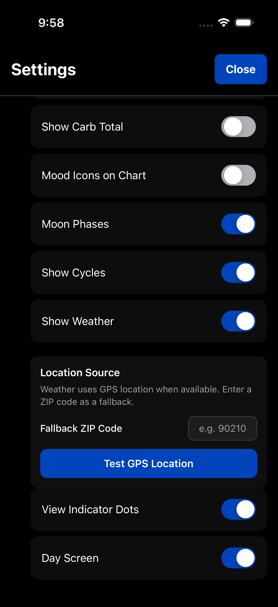
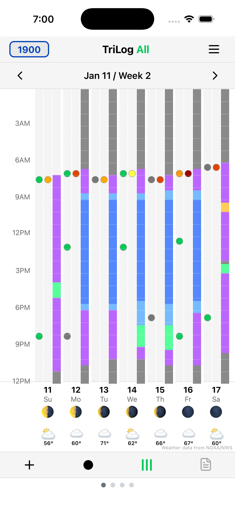
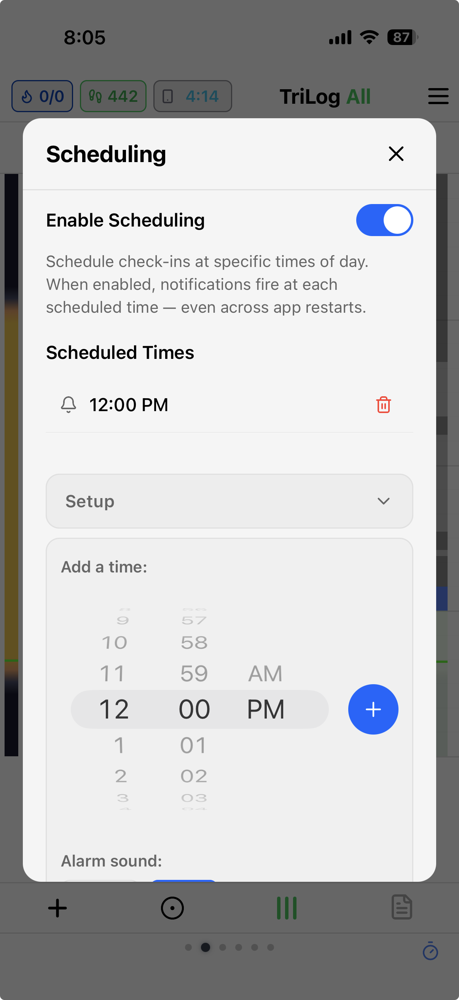

# Settings

TriLog offers extensive customization. Access Settings through the Menu.

## Appearance

Control how TriLog looks and what information displays.

### Display Options

- **Cycles** — Show menstrual cycle tracking indicators on the chart
- **Weather** — Display weather strip below the chart
- **Moon Phases** — Show lunar phase indicators
- **Steps Count** — Display daily steps in the header
- **Calorie Count** — Show daily calorie total in the header
- **Mood Icons** — Display mood emoji on the chart
- **Energy Half Steps** — Let the energy slider snap to halves (3.5) instead of whole numbers
- **View Indicator Dots** — Show navigation dots between views

### View Toggles

- **Trackers View** — Show/hide the Trackers grid
- **Habits View** — Show/hide the Habits grid
- **Day View** — Show/hide the single-day view (today's track + sun clock)
- **Screen Time View** — Show/hide the Screen Time swipeable view

Charts and day-ratings are no longer swipeable views — they live under **Menu → Analysis**. The old Charts/Ratings appearance toggles were removed.

Toggle off swipeable views you don't use to simplify navigation.

### HealthKit (iOS)

The **HealthKit** section holds per-metric toggles for what TriLog reads from Apple Health: Resting Heart Rate, Heart Rate Variability, Sleep Duration, Deep Sleep, REM Sleep, Steps, and calories. Enabled metrics are captured at Day End and shown in the Metrics grid.

## Theme

TriLog supports light and dark modes.

By default, the app follows your system preference. You can also set it manually:

- **Light** — White background, for daytime use
- **Dark** — Dark background, easier on eyes at night
- **System** — Follows your device setting

## Backup

Your data is stored locally on your device. Backup ensures you don't lose it.

### iCloud Backup (iOS)

Enable iCloud backup to automatically sync your data to Apple's cloud. This also syncs between devices signed into the same Apple ID.

### Exports

From **Settings → Backup & Restore** you can export:

- **CSV** — entries, daily summary, or tracker values, for Excel, Google Sheets, or AI analysis
- **Journal export** — a ZIP with your journal entries, photos, and a self-contained HTML viewer
- **Database + Photos Bundle** — your full SQLite database plus photos, readable by the free [desktop viewer](https://trilog.app/viewer.html)

### Google Sheets Export

Export your data to Google Sheets format for analysis in spreadsheets.

### Backup Reminders

TriLog reminds you if you haven't backed up recently. The app shows when your last backup occurred.

**Recommendation:** Enable iCloud backup if you're on iOS. It's automatic and reliable.

## Data Management

### Clear All Data

Deletes all entries, notes, and settings. Use with caution—this cannot be undone.

### Restore Purchases

If you've purchased Pro on another device, use this to restore your purchase.

## Scheduling

Set reminders at specific times of day to check in and log your mood. Access Scheduling from Menu → Tools → Scheduling.

This is a straightforward way to build a consistent logging habit. Set the times that make sense for your routine — morning, lunch, evening — and TriLog will nudge you.

## About

The About dialog (Menu → About) shows version information and includes a **"Replay Onboarding"** button. Tap it to re-experience the introductory walkthrough and guided demo at any time.

## Subscription

TriLog is one product with a 30-day free trial. Subscribe from the **Settings** screen.

- **Annual** — $59.99/year after the 30-day free trial
- **Monthly** — $7.99/month after the 30-day free trial
- **Restore Purchases** — if you subscribed on another device
- **Setup** — Menu → Extras → Setup (guided tracker and view setup)

If you stop subscribing, your data stays on your phone and the app becomes read-only — browsing, search, and export keep working.

See [Pro Features](pro-features.md) for a tour of what's included.

---

## Full Settings Reference

| Setting | Location | What It Does |
|---------|----------|--------------|
| Theme | Appearance | Light/dark mode |
| Cycles | Appearance | Cycle tracking display |
| Weather | Appearance | Weather strip on chart |
| Moon Phases | Appearance | Lunar indicators |
| Steps | Appearance | Steps in header |
| Calories | Appearance | Calorie total in header |
| Mood Icons | Appearance | Emoji on chart |
| View Dots | Appearance | Navigation indicators |
| Trackers View | Appearance | Grid view toggle |
| Habits View | Appearance | Grid view toggle |
| Health metrics | HealthKit | RHR, HRV, sleep, steps |
| Energy Half Steps | Appearance | Slider snaps to halves |
| iCloud Backup | Backup | Automatic backup |
| Export | Backup | Manual backup |
| Scheduling | Tools | Check-in reminders |
| Replay Onboarding | About | Re-run onboarding walkthrough |

---

[← Back to Guide](index.md) · [Next: Pro Features →](pro-features.md)
